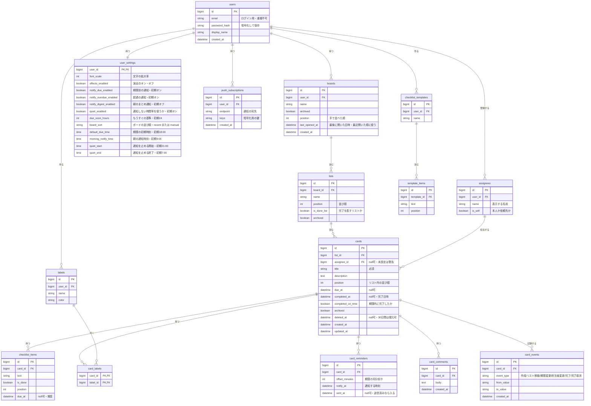

# ER図(データの設計)

関連要件: [requirements.md](../requirements.md) の F-10〜F-83。個人利用のため、「ユーザー」を中心に全データが1人に属する。

## 1. 全体図

## 2. テーブルの説明

| テーブル | 役割 | 主な関連要件 |
|---|---|---|
| users | 利用者のログイン情報 | F-01, N-07 |
| user_settings | 文字サイズ、演出のオン・オフ、通知しない時間帯 | F-61, F-71, N-13 |
| push_subscriptions | 通知を送る先(スマホごとに1件) | F-22 |
| boards | ボード | F-10 |
| lists | リスト。`is_done_list` が真のリストへ移すと完了扱い | F-11 |
| cards | タスク本体 | F-12, F-20 |
| assignees | 担当者の候補。`is_self` が真の行は登録時に自動作成。依頼先は入力するたびに追加 | F-30, F-31 |
| checklist_items | 準備の手順 | F-40, F-42 |
| labels / card_labels | ラベルとカードの対応(多対多) | F-14 |
| card_reminders | カードごとの通知タイミング | F-22 |
| card_comments | メモ | F-15 |
| card_events | 期限変更・リスト移動・完了の履歴 | F-25, F-43, F-74 |
| checklist_templates / template_items | よく使う手順の雛形 | F-44 |

## 3. 設計の考え方

1. **担当者は1名**: `cards.assignee_id` に1件だけ入れる。複数にはしない。
2. **依頼先は別テーブル**: 担当者を文字列でカードに直接入れると、同じ人の名前の表記がばらつく。`assignees` に分けておけば、候補表示(F-31)と絞り込み(F-34)ができる。
3. **依頼先の名前を変えても過去のカードは正しく表示される**: カードは名前そのものではなく `assignee_id` で参照するため。
4. **実績の元データ**: 期限内完了率(F-72)は `completed_at` と `due_at` から計算する。完了時点の判定を `completed_on_time` に保存しておけば、あとで期限を変えても過去の実績は変わらない。
5. **履歴は `card_events` に追記だけする**: 消さない。期限・リスト移動・完了を同じ形で残せる。
6. **誤削除の復元**: 削除は `deleted_at` に日時を入れるだけにして、30日後に本当に消す(N-09)。
7. **他人のデータを見せない**: すべてのデータをたどると `users` にたどり着く。取得時は必ず「自分のユーザーID」で絞る(N-07)。

## 4. 画面とのつながり

| 画面 | 主に使うテーブル |
|---|---|
| ボード(S-03) | boards, lists, cards, checklist_items, assignees, labels |
| カード詳細(S-04) | cards, checklist_items, card_reminders, card_comments, card_events |
| 自分のタスク(S-05) | cards(`due_at` 順), assignees |
| 実績(S-07) | cards(`completed_at`, `completed_on_time`), card_events |
| 設定(S-06) | user_settings, push_subscriptions |

## 5. 未決事項

| No. | 内容 |
|---|---|
| ER-01 | データを置く場所(端末のみ / サーバー)。ログインと通知を使うため、サーバーに置く前提で設計している |
| ER-02 | 使うデータベースの種類(技術選定の段階で決める) |
| ER-03 | 依頼先の名前の重複(同姓の別人)を許すか |
