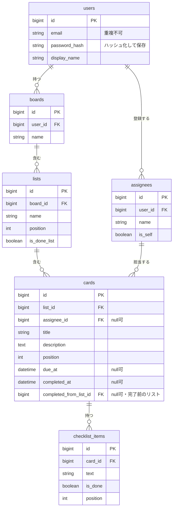

# 最小版(MVP)の範囲

| 項目 | 内容 |
|---|---|
| 状態 | 初版(版 0.1)・確認待ち |
| 方針 | まず動く最小版を作る。残りの機能は、最小版が動いてから足す |
| 開発期間 | 期限なし。実装は研修で学びながら進める |

## 1. 最小版でできること

> 利用者が、ボードの上でカードを作り、担当者と期限と準備の手順を決め、終わったら完了にできる。

これだけを、確実に動かす。

## 2. 含める機能・後回しにする機能

### 含める(最小版)
| 機能 | 内容 | 元の要件 |
|---|---|---|
| 会員登録・ログイン・ログアウト | メールアドレスとパスワードで登録・ログイン。自分のデータだけが見える | F-01 |
| ボードの表示 | 会員登録のときに、初期リスト3つ(未着手 / 進行中 / 完了。完了は、いつも、いちばん右)を持つボードを1つ作り、表示する | F-10, F-11 |
| カードの作成・編集・削除 | タイトル、説明 | F-12 |
| カードの移動 | ドラッグで、リストの間・リストの中を入れ替える(マウス・スマホの長押し・キーボード)。「完了」へ入れると完了、出すと未完了に戻る。「リストを変更」の操作は、カード詳細を作るときに | F-13 |
| 担当者 | 1名。自分、または依頼先の名前を文字で入力 | F-30〜F-33 |
| 期限 | 日時の設定と、状態の表示(通常 / もうすぐ / 超過 / 完了)。アイコン・文字つき | F-20, F-21 |
| チェックリスト | 項目の追加、完了、進み具合(例: 3/5)。**実装済み: カード一覧の進み具合の表示と、編集ダイアログでの項目の一覧(表示のみ)。まだ: 項目の追加・完了の操作** | F-40, F-42 |
| 完了 | ○ をタップして完了にし、完了日時を記録 | UC-04 |
| 自分のタスク | 未完了のカードを、期限が近い順に一覧 | F-24 |

### 後回しにする(最小版には含めない)
| 後回しの機能 | 理由 |
|---|---|
| メール確認、パスワード再設定、ログイン失敗の回数制限、「ログイン状態を保つ」の期間の設定 | 最小版は、メールアドレスとパスワードによる登録・ログインだけにする。メールを送る仕組みは別の学習が必要 |
| 通知(期限前のお知らせ) | 端末への通知は、別の学習が必要 |
| 実績の画面 | 完了日時だけは最初から記録しておく。画面は後 |
| 設定画面(通知時刻、文字サイズ、依頼先の管理) | 最小版は初期値で動かす |
| ボードの複数作成・アーカイブ・並び替え | 最小版はボード1つ |
| ごみ箱、データの書き出し、退会 | 動くものができてから |
| ラベル、メモ、履歴、検索、チェックリストの雛形 | 推奨機能 |
| カレンダーに追加 | 最小版の次に足す(比較的やさしい) |
| 完了の演出、オフライン対応 | 見た目と操作の仕上げ |

## 3. 最小版の画面

| 画面 | 元の仕様 | 最小版での簡略化 |
|---|---|---|
| ボード画面 | [screen-board.md](screen-board.md) | 検索、期限順の並べ替え、リストの追加・並び替えは外す(カードの長押し・ドラッグ移動は、実装した) |
| カード詳細 | [screen-card-detail.md](screen-card-detail.md) | 通知、カレンダー、ラベル、メモ、履歴、雛形は外す |
| 自分のタスク | [screen-my-tasks.md](screen-my-tasks.md) | 「自分 / 依頼中 / 全て」の切り替えと、完了の表示は外す(未完了を期限順に並べるだけ) |
| ログイン / 会員登録 | [screen-login.md](screen-login.md) | ログインと会員登録の2画面だけ。メール確認、パスワード再設定、失敗の回数制限、「ログイン状態を保つ」は外す。会員登録の入力は、表示名・メールアドレス・パスワード(8文字以上、英字と数字を含む)。同意の確認欄も外す |

- ログアウトは、設定画面がないため、ボード画面の ⋯ メニューに置く。
- ボード一覧、設定、実績は、最小版には作らない。

## 4. 最小版のデータ

使うテーブルは6つ。

- 全体の設計は [er-diagram.md](er-diagram.md)。最小版は、その一部だけを使う。
- 後から足す列(`completed_on_time` など)は、その機能を作るときに追加する。

## 5. 最小版の API(案)

「Read(取得)」から作り、そのあと作成・更新・削除を足す。

| 種類 | 呼び出し | 内容 |
|---|---|---|
| 取得(実装済み) | `GET /api/board` | ボード全体(リストと、その中のカード) |
| 取得(実装済み) | `GET /api/cards/{id}` | カード1枚の詳細(チェックリスト含む)。無ければ 404 |
| 取得(実装済み) | `GET /api/tasks` | 自分のタスク(未完了を期限順。期限なしは最後) |
| 取得 | `GET /api/assignees` | 担当者の候補 |
| 作成(実装済み) | `POST /api/cards` | カードを作る。本文 `{listId, title}`。201 と作ったカードを返す。リストの最後・担当者は自分・期限なし。入力が正しくなければ 400、リストが無ければ 404 |
| 作成 | `POST /api/cards/{id}/checklist-items` | チェックリストの項目を足す |
| 作成 | `POST /api/assignees` | 依頼先の名前を足す |
| 更新(期限は実装済み) | `PATCH /api/cards/{id}` | 送った項目だけを変える(部分更新)。いまは期限だけ: 本文 `{"dueAt": "2026-11-10T18:00:00+09:00"}`(設定)/ `{"dueAt": null}`(消す)。200 と更新後のカードを返す。空の本文・更新できない項目・時差の無い日時・範囲外(2000〜2100年以外)は 400、カードが無ければ 404。リスト・並び順・完了日時は変えない。タイトル・説明・担当者は、あとで同じ口に足す |
| 更新(実装済み) | `PATCH /api/cards/{id}/move` | 別のリストへ移す・同じリストで入れ替える。本文 `{listId, position}`。「完了」リストへ移すと完了日時を記録、出すと消す。200 と動かしたカードを返す。カード・リストが無ければ 404、別ボード・位置が 1 未満は 400 |
| 更新(実装済み) | `PATCH /api/cards/{id}/complete` | 完了にする / 未完了に戻す。本文 `{"completed": true \| false}`(省略できる `position`)。完了 = 「完了」リストの**いちばん上**へ・完了日時を記録・完了前のリストを覚える。戻す = 完了前のリストの**最後**へ・完了日時と記録を消す(行き先が無い・消えた・別のボードなら、いちばん左の開いたリスト)。すでにその状態なら変えずに 200。400(completed なし・位置が1未満)・404。画面の完了マークのタップは、別の作業 |
| 更新 | `PATCH /api/checklist-items/{id}` | 項目の完了を切り替える・文言を変える |
| 削除(実装済み) | `DELETE /api/cards/{id}` | カードを**物理削除**(DB から本当に消える。元に戻せない)。204(中身なし)。そのカードのチェックリストも消える。同じリストに残ったカードの並び順は、1,2,3… に振り直す。カードが無ければ 404 |
| 削除 | `DELETE /api/checklist-items/{id}` | 項目を削除する |
| 認証 | `POST /api/auth/register` | 会員登録(登録と同時に、初期のボードとリストと「自分」の担当者を作る) |
| 認証 | `POST /api/auth/login` | ログイン |
| 認証 | `POST /api/auth/logout` | ログアウト |

- 呼び出しの名前は案。研修で教わる書き方に合わせて直す。
- 会員登録とログイン以外の API は、ログインしていないと使えない。
- 他の人のカードやボードは、見ることも変えることもできない(自分のユーザーID で絞って取得する)。
- ログインの方式(セッションか、トークンか)は、研修で教わる方式に合わせる。

## 6. 課題の進め方との対応

| 課題の項目 | この設計書での対応 |
|---|---|
| データの可視化 | ER図([er-diagram.md](er-diagram.md))と、最小版のデータ(上の §4) |
| プロトタイプ作成 | 画面仕様と、最小版の3画面(§3) |
| 実装: Spring Boot プロジェクト作成 | 最小版の土台 |
| 実装: DB構築と接続 | §4 の5つのテーブルを作り、アプリと接続する |
| 実装: API実装 | §5 の API。まず取得(Read) |

## 7. 作る順番(案)

| 段階 | 内容 |
|---|---|
| 最小版 | §2 の「含める」機能 |
| 第2段階 | メール確認とパスワード再設定、期限前の通知、カレンダーに追加、実績の画面 |
| 第3段階 | 設定、ボードの複数化、ラベル・メモ・履歴、データの書き出し、ごみ箱 |
| 仕上げ | 完了の演出、オフライン対応、退会 |

## 8. 未決事項
| No. | 内容 |
|---|---|
| M-03 | 課題の「Read と Claude GitHub の設定」は、何を指すか(API の取得機能と、GitHub の設定のことか) |
| M-05 | DB の種類の指定があるか(研修で使うもの) |
| M-06 | ログインの方式(セッションか、トークンか)に、研修での指定があるか |

次回(研修の動画を見てから)に返事をもらう。

### 決定済み
| 内容 | 決定 |
|---|---|
| 最小版の範囲 | ログインあり(登録・ログイン・ログアウトのみ)、自分のデータだけを扱う、ボードは1つ |
| 課題の「データの可視化」 | ER 図 |
| 対応ブラウザ | Chrome と Safari |
| 初期データ | 会員登録のときに自動で作る |
| 確認の方法 | 手作業の確認表と、API の確認(Postman か curl) |
| テーブルの作り方 | SQL ファイル(`backend/src/main/resources/db/schema.sql`)。起動時に自動で実行する。定義は [table-definition.md](table-definition.md) |
| 同じ名前の担当者 | 同じ利用者の中では、同じ名前を2回登録できない(既存の人を選ぶ。ER-03 の決着) |
| 優先度 | **専用の項目は作らない。リストの中の上下の位置で表す**(上ほど優先度が高い)。変えるときは、カードをドラッグで上下に動かす。優先度の段階(高・中・低)や、優先度で並べる機能も作らない |
| 期限の更新 | `PATCH /api/cards/{id}` の `dueAt` だけ(時差つきの日時。null で消す)。完了済みのカードの期限も変えられる(完了のまま)。画面は、カードを押すと、ボードの上に編集ダイアログが開く形(実装済み。クイック選択は 18:00 固定。過去の日時は確認。全画面のカード詳細は、あとで) |
| カードの削除 | 最小版は**物理削除**(ごみ箱で30日復元する設計(画面仕様 カード詳細 §3-①、要件 N-09)は、第3段階)。API は成功で 204(中身なし)。チェックリストは DB の ON DELETE CASCADE で一緒に消え、残ったカードの並び順は連番に振り直す。**画面では、削除の前に必ず確認を出す**(要件 NM-08。編集ダイアログの「このカードを削除」→「削除する」/「やめる」。実装済み。最初のフォーカスは「やめる」) |
| 取得 API(ボード・カード・タスク) | DB のデータを返す。ログイン前は、ボードは id が最小の 1 つを返す(ログインを作る段階で user_id で絞る)。データが無いときは 500 ではなく 404 と理由を返す |
| テストデータ | `db/seed.sql` をプロファイル `seed` で入れる(通常の起動では入らない)。起動のたびにデモ利用者のデータを作り直す |
| 画面の作り方(M-04 の決着) | React(JavaScript から API を呼ぶ方式)。TypeScript、Vite、プロジェクトは `frontend/`。開発中は、Vite が `/api` をバックエンドへ中継する。研修の指定が違えば見直す |
| パソコンでの表示 | 画面幅に合わせて広げる(幅 768px 以上で、リストの幅を画面に合わせて 180〜280px に縮めて、リストが4つあっても全部見えるようにする)。詳細は [screen-board.md](screen-board.md) の §11。課題が「WEB 版」か「スマホ版」かは、講師の回答待ち |
| 画面の範囲(いま) | ボード画面の表示、カードの追加、カードの入れ替え(ドラッグ)、カードの編集ダイアログ(期限の変更・削除)、**完了マーク(○/✔)のタップ(確認・5秒の「元に戻す」つき)**。タイトルや担当者の編集・検索・ログイン・画面の切り替えは、次の段階 |
| 完了前のリスト | `cards.completed_from_list_id`(1 列。履歴テーブルは作らない)に覚える。ドラッグ(move)で「完了」へ入れたときも記録し、出したら消す。✔ で、そのリストの最後へ戻す。起動時に `ALTER TABLE ... ADD COLUMN IF NOT EXISTS` で足す(データは消えない) |
| 完了にしたカードの入れ先 | 「完了」リストの、**いちばん上**(新しい完了が上。リストが長くても、すぐ見える) |
| カードの入れ替え | `PATCH /api/cards/{id}/move`(位置は 1 から。移し先・元のリストを 1,2,3… に振り直す)。画面は @dnd-kit(マウスは約 8px 動かすと開始、スマホは約 0.5 秒の長押し、キーボードは Space と矢印)。置いたらすぐ画面に反映し、保存に失敗したら元に戻して理由を出す。「完了」へ入れると自動で完了(完了日時を記録)、出すと未完了に戻る。別のボードへは動かせない |
| カードの追加(Create) | タイトルだけで作る(1〜100文字。前後の空白は取る)。リストの最後、担当者は自分、期限なし。追加したあとも入力欄は開いたまま(続けて追加できる)。「完了」リストには追加できない(画面にボタンを出さない。API も 400) |
| iPhone での確認と公開の範囲 | バックエンド(8080)は、パソコンの中(127.0.0.1)だけで待ち受ける。iPhone などで見るときだけ、`./dev.sh front-phone` で、画面のサーバー(5173)を、自宅の同じ Wi-Fi に公開する(ログインが無いので、試す間だけ。iPhone からは、画面のサーバー経由でしか API に届かない)。要件 NM-01 |
| 開発環境(仮) | Java 21、Maven、Spring Boot 4.1.2。プロジェクトは `backend/`。研修の指定が違えば見直す |
