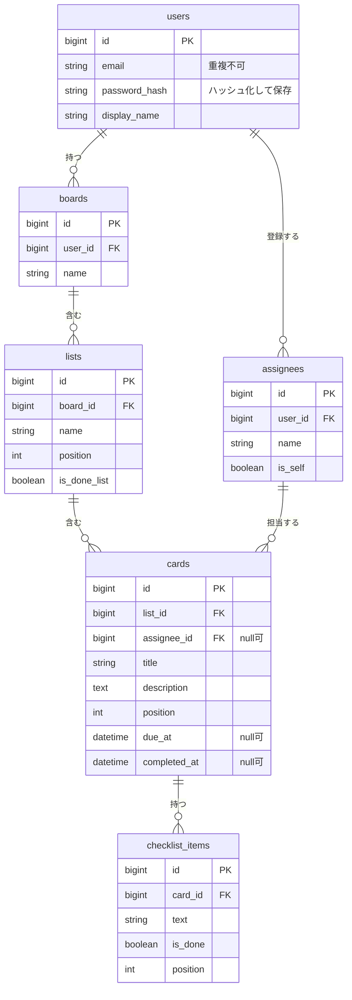

# 最小版(MVP)の範囲

| 項目 | 内容 |
|---|---|
| 状態 | 初版(版 0.1)・確認待ち |
| 方針 | まず動く最小版を作る。残りの機能は、最小版が動いてから足す |
| 開発期間 | 期限なし。実装は研修で学びながら進める |

## 1. 最小版でできること

> 利用者が、ボードの上でカードを作り、担当者と期限と準備の手順を決め、終わったら完了にできる。

これだけを、確実に動かす。

## 2. 含める機能・後回しにする機能

### 含める(最小版)
| 機能 | 内容 | 元の要件 |
|---|---|---|
| 会員登録・ログイン・ログアウト | メールアドレスとパスワードで登録・ログイン。自分のデータだけが見える | F-01 |
| ボードの表示 | 会員登録のときに、初期リスト4つ(未着手 / 進行中 / レビュー / 完了)を持つボードを1つ作り、表示する | F-10, F-11 |
| カードの作成・編集・削除 | タイトル、説明 | F-12 |
| カードの移動 | まずは「リストを変更」の操作で移す(長押しドラッグは後回し) | F-13 |
| 担当者 | 1名。自分、または依頼先の名前を文字で入力 | F-30〜F-33 |
| 期限 | 日時の設定と、状態の表示(通常 / もうすぐ / 超過 / 完了)。アイコン・文字つき | F-20, F-21 |
| チェックリスト | 項目の追加、完了、進み具合(例: 3/5) | F-40, F-42 |
| 完了 | ○ をタップして完了にし、完了日時を記録 | UC-04 |
| 自分のタスク | 未完了のカードを、期限が近い順に一覧 | F-24 |

### 後回しにする(最小版には含めない)
| 後回しの機能 | 理由 |
|---|---|
| メール確認、パスワード再設定、ログイン失敗の回数制限、「ログイン状態を保つ」の期間の設定 | 最小版は、メールアドレスとパスワードによる登録・ログインだけにする。メールを送る仕組みは別の学習が必要 |
| 通知(期限前のお知らせ) | 端末への通知は、別の学習が必要 |
| 実績の画面 | 完了日時だけは最初から記録しておく。画面は後 |
| 設定画面(通知時刻、文字サイズ、依頼先の管理) | 最小版は初期値で動かす |
| ボードの複数作成・アーカイブ・並び替え | 最小版はボード1つ |
| ごみ箱、データの書き出し、退会 | 動くものができてから |
| ラベル、メモ、履歴、検索、チェックリストの雛形 | 推奨機能 |
| カレンダーに追加 | 最小版の次に足す(比較的やさしい) |
| 完了の演出、長押しでの移動、オフライン対応 | 見た目と操作の仕上げ |

## 3. 最小版の画面

| 画面 | 元の仕様 | 最小版での簡略化 |
|---|---|---|
| ボード画面 | [screen-board.md](screen-board.md) | 検索、期限順の並べ替え、リストの追加・並び替え、長押し移動は外す |
| カード詳細 | [screen-card-detail.md](screen-card-detail.md) | 通知、カレンダー、ラベル、メモ、履歴、雛形は外す |
| 自分のタスク | [screen-my-tasks.md](screen-my-tasks.md) | 「自分 / 依頼中 / 全て」の切り替えと、完了の表示は外す(未完了を期限順に並べるだけ) |
| ログイン / 会員登録 | [screen-login.md](screen-login.md) | ログインと会員登録の2画面だけ。メール確認、パスワード再設定、失敗の回数制限、「ログイン状態を保つ」は外す。会員登録の入力は、表示名・メールアドレス・パスワード(8文字以上、英字と数字を含む)。同意の確認欄も外す |

- ログアウトは、設定画面がないため、ボード画面の ⋯ メニューに置く。
- ボード一覧、設定、実績は、最小版には作らない。

## 4. 最小版のデータ

使うテーブルは6つ。

- 全体の設計は [er-diagram.md](er-diagram.md)。最小版は、その一部だけを使う。
- 後から足す列(`completed_on_time` など)は、その機能を作るときに追加する。

## 5. 最小版の API(案)

「Read(取得)」から作り、そのあと作成・更新・削除を足す。

| 種類 | 呼び出し | 内容 |
|---|---|---|
| 取得 | `GET /api/board` | ボード全体(リストと、その中のカード) |
| 取得 | `GET /api/cards/{id}` | カード1枚の詳細(チェックリスト含む) |
| 取得 | `GET /api/tasks` | 自分のタスク(未完了を期限順) |
| 取得 | `GET /api/assignees` | 担当者の候補 |
| 作成 | `POST /api/cards` | カードを作る |
| 作成 | `POST /api/cards/{id}/checklist-items` | チェックリストの項目を足す |
| 作成 | `POST /api/assignees` | 依頼先の名前を足す |
| 更新 | `PUT /api/cards/{id}` | タイトル、説明、担当者、期限を変える |
| 更新 | `PATCH /api/cards/{id}/move` | 別のリストへ移す |
| 更新 | `PATCH /api/cards/{id}/complete` | 完了にする / 完了を戻す |
| 更新 | `PATCH /api/checklist-items/{id}` | 項目の完了を切り替える・文言を変える |
| 削除 | `DELETE /api/cards/{id}` | カードを削除する |
| 削除 | `DELETE /api/checklist-items/{id}` | 項目を削除する |
| 認証 | `POST /api/auth/register` | 会員登録(登録と同時に、初期のボードとリストと「自分」の担当者を作る) |
| 認証 | `POST /api/auth/login` | ログイン |
| 認証 | `POST /api/auth/logout` | ログアウト |

- 呼び出しの名前は案。研修で教わる書き方に合わせて直す。
- 会員登録とログイン以外の API は、ログインしていないと使えない。
- 他の人のカードやボードは、見ることも変えることもできない(自分のユーザーID で絞って取得する)。
- ログインの方式(セッションか、トークンか)は、研修で教わる方式に合わせる。

## 6. 課題の進め方との対応

| 課題の項目 | この設計書での対応 |
|---|---|
| データの可視化 | ER図([er-diagram.md](er-diagram.md))と、最小版のデータ(上の §4) |
| プロトタイプ作成 | 画面仕様と、最小版の3画面(§3) |
| 実装: Spring Boot プロジェクト作成 | 最小版の土台 |
| 実装: DB構築と接続 | §4 の5つのテーブルを作り、アプリと接続する |
| 実装: API実装 | §5 の API。まず取得(Read) |

## 7. 作る順番(案)

| 段階 | 内容 |
|---|---|
| 最小版 | §2 の「含める」機能 |
| 第2段階 | メール確認とパスワード再設定、期限前の通知、カレンダーに追加、実績の画面 |
| 第3段階 | 設定、ボードの複数化、ラベル・メモ・履歴、データの書き出し、ごみ箱 |
| 仕上げ | 完了の演出、長押し移動、オフライン対応、退会 |

## 8. 未決事項
| No. | 内容 |
|---|---|
| M-03 | 課題の「Read と Claude GitHub の設定」は、何を指すか(API の取得機能と、GitHub の設定のことか) |
| M-04 | 画面は、Spring Boot が HTML を返す方式か、JavaScript から API を呼ぶ方式か(研修で指定があるか) |
| M-05 | DB の種類の指定があるか(研修で使うもの) |
| M-06 | ログインの方式(セッションか、トークンか)に、研修での指定があるか |

次回(研修の動画を見てから)に返事をもらう。

### 決定済み
| 内容 | 決定 |
|---|---|
| 最小版の範囲 | ログインあり(登録・ログイン・ログアウトのみ)、自分のデータだけを扱う、ボードは1つ |
| 課題の「データの可視化」 | ER 図 |
| 対応ブラウザ | Chrome と Safari |
| 初期データ | 会員登録のときに自動で作る |
| 確認の方法 | 手作業の確認表と、API の確認(Postman か curl) |
